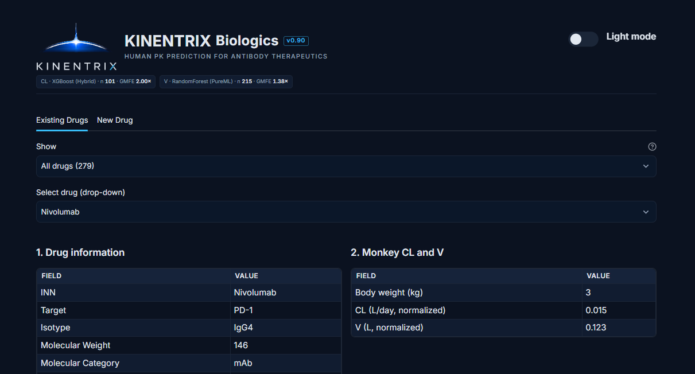
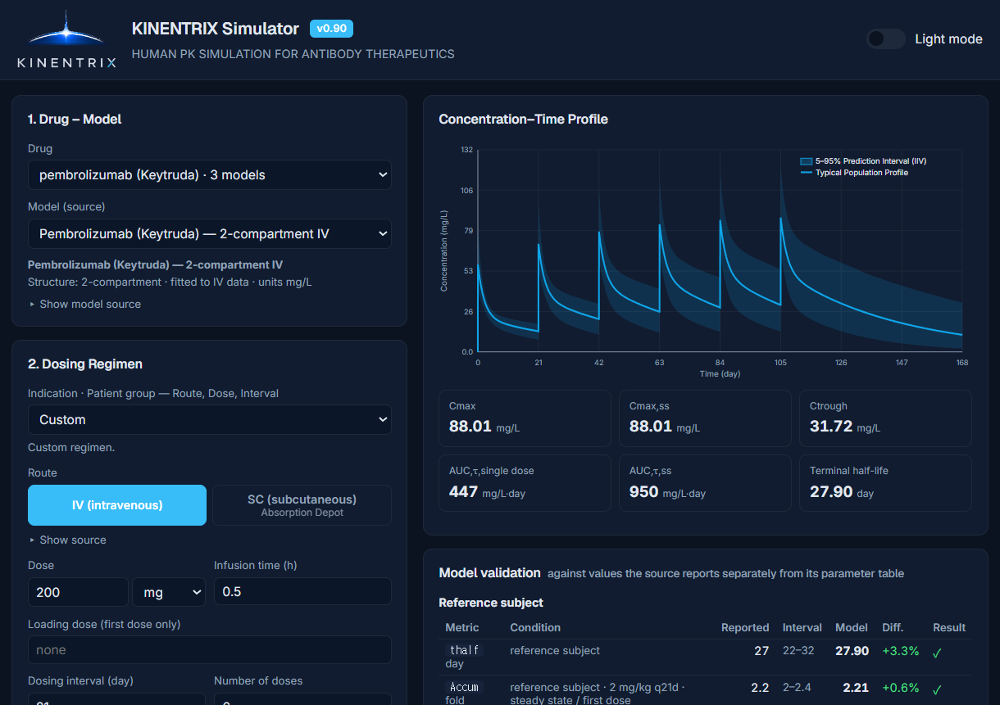

# APLUS Simulation

### AI-Powered Pharmacometrics Modeling & Simulation for Prediction Tools and Quantitative Solutions

**From Data to Prediction. From Models to Decisions.**

[Website](https://www.aplus-sim.com) · [LinkedIn](https://www.linkedin.com/company/aplus-simulation)

---

## 🔬About Us

APLUS Simulation is a Korea Seoul-based pioneer group in AI-powered pharmacometrics and model-informed drug development, bridging advanced Clinical Pharmacology with with artificial intelligence. 

Our expertise spans quantitative system models, PK/PD modeling, translational simulation, and AI/ML-driven prediction, which we actively apply to real-world drug development projects.

---

## 💻Our Softwares

### 🧬KINENTRIX® Biologics (0.90)
**AI-Powered Human PK Prediction Platform for Antibody Therapeutics**

**Key Capabilities**

- Human CL and V prediction via machine learning-based prediction
- AI-enhanced prediction performance for cross-species scaling
- Human PK profile simulation based on best schema & method 
- Population PK reference comparison
- New antibody PK prediction using selected prediction schema & method

[Explore KINENTRIX Biologics](https://github.com/aplus-sim/Kinentrix_Biologics_0.90)

  

### 📈KINENTRIX® Simulator (0.90)
**Human PK Simulation Platform**

**Key Capabilities**

- PK profile simulation for approved antibody drugs
- Virtual Population exposure prediction and visualization
- Covariate-informed simulations using covariate models
- Extraction of individual parameters and time-series population profiles data

[Explore KINENTRIX Simulator](https://github.com/aplus-sim/Kinentrix_Simulator_0.90)

---

## 🛠️Technology & Expertise

---

## 🚀Research & Innovation

- AI-powered human PK prediction for biologics
- Mechanistic and translational PK/PD modeling
- AI/ML-enhanced pharmacometrics
- Model-informed drug development
- Future expansion toward advanced modalities, and PD modules

---

## 🌐Connect With Us

GitHub: https://github.com/aplus-sim

Website: https://www.aplus-sim.com

LinkedIn: https://www.linkedin.com/company/aplus-simulation

---

**APLUS Simulation**

© 2026 APLUS Simulation. All Rights Reserved.

<!--© 2026 APLUS Simulation. All rights reserved-->

<!--
**aplus-sim/aplus-sim** is a ✨ _special_ ✨ repository because its `README.md` (this file) appears on your GitHub profile.

Here are some ideas to get you started:

- 🔭 I’m currently working on ...
- 🌱 I’m currently learning ...
- 👯 I’m looking to collaborate on ...
- 🤔 I’m looking for help with ...
- 💬 Ask me about ...
- 📫 How to reach me: ...
- 😄 Pronouns: ...
- ⚡ Fun fact: ...
-->
